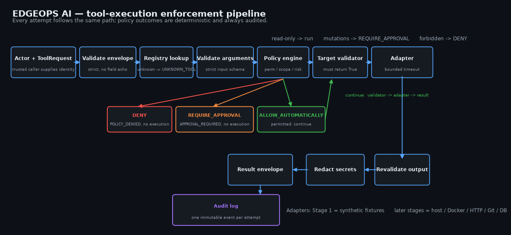

# EDGEOPS AI

**Evidence-backed operations through typed, capability-limited tools.**

> Deterministic tools collect facts.  
> Local models compress and classify facts.  
> Better models reason only when the evidence and task justify escalation.  
> Humans approve meaningful changes.

EDGEOPS is an AI-assisted operations platform for small-to-medium infrastructure and industrial-software environments. It is built to cut the operation that matters — time from alert to an auditable, verified fix — without ever giving an AI agent free shell access. Instead of arbitrary commands, every capability is a **typed tool** with an enforced contract: strict schemas, explicit permissions, an exact target scope, a risk classification, a timeout, and an audit event for every attempt.

What the design refuses to do is as defining as what it does: no arbitrary shell, no un-auditable output, no model that can authorize its own action, and no "root cause" claim that wasn't verified by an observed recovery.

## The safety core, in five attempts

This is the actual output of the built-in safety showcase — a read succeeds, and every risky attempt is stopped deterministically before an adapter runs. This is the promise in one command:

```console
$ edgeops-safety-demo
read-only tool, permitted caller               -> success -
unregistered tool                              -> error  UNKNOWN_TOOL
production target, not in caller scope         -> error  POLICY_DENIED
mutation, correctly permitted and targeted     -> error  APPROVAL_REQUIRED
forbidden risk category                        -> error  POLICY_DENIED
Audit events: 5 -- every attempt, including denials, is audited.
```

Key mechanics behind the output:

- **Policy is deterministic, never model judgment.** A simple rule engine gates on permission + exact target scope (host *and* environment *and* resource) + risk level. `APPROVAL_REQUIRED` is a real, first-class policy decision that mutation-bound tools hit — there is no approval override or mutation execution path yet by design (Stage 10 adds the approval service).
- **Denied calls never reach the adapter.** The showcase's mutating adapters raise if invoked; passing 27 unit tests alongside this output means "blocked" is enforced, not promised.
- **Everything is audited**, including failures, denials, timeouts, and cancellations, so every attempt leaves an immutable event with correlation and evidence IDs.

## Run it locally

Requires Python 3.11+ and Pydantic 2.13+. From this project folder in PowerShell:

```powershell
python -m venv .venv
.\.venv\Scripts\python.exe -m pip install -e .
.\.venv\Scripts\python.exe -m edgeops.demo
.\.venv\Scripts\python.exe -m edgeops.safety_demo
.\.venv\Scripts\python.exe -m unittest discover -s tests -v
```

On Linux/macOS, use `.venv/bin/python` and `export PYTHONPATH=src` (or install with `pip install -e .`). The installed commands `edgeops-demo` and `edgeops-safety-demo` run the same scripts. No database, Docker, Ollama, network access, or credentials are needed.

The full demo prints two successful JSON result envelopes and `Audit events: 2`:

```json
{
  "status": "success",
  "tool_name": "get_demo_disk_usage",
  "target": { "host_id": "demo-host", "resource_id": null, "environment": "local" },
  "observed_at": "2026-10-25T02:07:48.832306Z",
  "duration_ms": 0,
  "correlation_id": "0c9c5e1d-aa6b-4fa9-b6d7-179f0ca378a6",
  "evidence_id": "23be9e4a-d03a-4556-8c02-0aa2b65b6e89",
  "data": { "mount": "/", "total_bytes": 100000, "used_bytes": 25000,
            "source": "synthetic_fixture" },
  "warnings": [],
  "redactions_applied": [],
  "error": null
}
```

Every result carries a UTC timestamp, a monotonic duration, a correlation ID for related calls, and an evidence ID matching a paired audit event. Secrets are recursively redacted from output: sensitive field names, Bearer tokens, `password=...` payloads, credentials in URLs, and PEM private-key blocks — with the redaction category recorded on the envelope (`redactions_applied`), not just silently.

Disk usage here is fixed fixture data (25,000 used bytes out of 100,000). The Stage 1 demo tools are synthetic; they deliberately do not inspect your machine.

## How the enforcement pipeline works

Every tool execution, for every caller, goes through the same pipeline — no path skips validation, policy, or audit:



The same pipeline in text form:

```text
Actor + ToolRequest  (trusted service layer supplies identity; requests never self-authorize)
  -> strict envelope validation        malformed input -> structured error, no echo
  -> registry lookup                   unknown tool -> UNKNOWN_TOOL
  -> schema-validated arguments        strict Pydantic: no unknown fields, no coercion
  -> policy engine                     permission + exact target scope + risk level
  -> tool-specific target validator    must return literal True
  -> adapter (if allowed)              cooperative async, bounded timeout
  -> output revalidation -> redaction -> normalized envelope
  -> audit event                       always, for every outcome
```

Modules: [tools/contracts.py](src/edgeops/tools/contracts.py) (schemas, risk, idempotency, identity, tool definition) · [tools/registry.py](src/edgeops/tools/registry.py) (trusted registration; rejects permissive schemas, duplicate names, inconsistent metadata, out-of-range timeouts) · [tools/policy.py](src/edgeops/tools/policy.py) (deterministic permission/target/risk decisions) · [tools/executor.py](src/edgeops/tools/executor.py) (the pipeline above, including cancellation, exception secrecy and audit tracking) · [core/redaction.py](src/edgeops/core/redaction.py) (recursive masking) · [tools/definitions/demo.py](src/edgeops/tools/definitions/demo.py) (opted-in synthetic adapters) · [edgeops/safety_demo.py](src/edgeops/safety_demo.py) (the showcase above).

Stage 1 has 7 focused unit test files (27 tests) covering registration safety, all risk categories, exact target scope, malformed input/output, exception secrecy, recursive redaction, timeout and cancellation paths, concurrent evidence IDs, and immutable audit snapshots.

## Where the product goes

| Stage | Adds | Status |
|---|---|---|
| 0 | Baseline (reusable knowledge stack; partially deferred in this workspace) | deferred |
| 1 | Typed tool foundation — contracts, registry, policy, executor, audit, fixtures | **done** |
| 2 | Read-only local host inspection + minimal CLI/API exposure | next |
| 3–4 | Docker inspection; services/hosts model with stored evidence | planned |
| 5–6 | Incident lifecycle, timeline, evidence store; RAG knowledge integration | planned |
| 7–9 | Local LLM summarization; deterministic model router; evidence-linked hypothesis engine | planned |
| 10 | First controlled remediation: approval service, idempotency keys, verification | planned |
| 11–16 | Remote targets; model escalation; workers; full observability stack; hardened deployment | planned |

Each phase lands as: implement the stage, test it, document it, keep the foundation contract-stable. The differentiation at scale (deterministic router budgets, verifiable-cause state machine, evidence-linked incident memory) is designed in the technical blueprint rather than improvised later.

## Project documentation

- [Architecture and lifecycle](docs/architecture.md)
- [Architecture diagram](docs/architecture-diagram.png) (regenerate: `python scripts/generate_architecture_diagram.py`)
- [Tool catalog and extension guide](docs/tool-catalog.md)
- [Phase tracker and validation record](docs/development-stages.md)
- [Baseline decision](docs/adr/0001-standalone-tool-foundation.md)
- [Original technical blueprint](docs/technical-blueprint.md)
- [Visual overview](docs/edgeops-overview.html)

Stage 0 remains partially deferred: this workspace contained no AeroIntel source or configured infrastructure. Existing PostgreSQL/pgvector/Ollama/embedding retrieval has not been verified. Stage 1 intentionally has no dependency on that stack. Stage 2 will add read-only local host inspection after the Stage 1 checkpoint.

## Scope and limitations

This is an internal Python library and fixture demo, not a deployed operations service. Authentication, durable auditing, approval records, idempotent mutations, real adapters, API routes and models belong to later phases. Audit memory is in-process and disappears when the process exits. Generic redaction is defense in depth; future adapters must produce bounded, sanitized data themselves. This is a capability boundary for callers, not a Python sandbox: only reviewed adapters should be registered, and trusted application code creates actors and registrations. See the architecture document for the trusted-code and timeout boundaries — and for what later adapters must do to remain bounded and opaque to the caller.
